# Netskope provisioning with the on-prem UPN

**The problem:** In UPN-based enrollment, the Netskope Client identifies the user by the UPN of the person signed in to Windows (`whoami /upn`), which is the on-premises UPN. That value has to match the `userName` Microsoft Entra provisions to Netskope over SCIM ([Netskope: client enrollment using UPN](https://docs.netskope.com/en/netskope-client-enrollment-using-upn)). Where Active Directory uses a domain that isn't verified in Entra, the cloud UPN is different, so the default mapping sends the wrong name. Existing accounts don't match, and Entra creates duplicates. The tempting fix, adding `onPremisesUserPrincipalName` to the app's schema by hand, puts the provisioning job into quarantine.

**What I built:** A fresh forest, rwandacorporation.local, synced to Entra with Connect Sync, and the Netskope User Authentication gallery app provisioning to a small SCIM 2.0 test server in Azure App Service, which stands in for Netskope. I reproduced the schema edit and its SchemaInvalid quarantine, found which part of the edit causes it, and then applied the supported fix: a Connect Sync rule copies the on-prem UPN into `extensionAttribute10`, and the app's `userName` is mapped from that attribute. Last, I added monitoring that would have caught the problem on the first day.

| Piece | Setting |
| --- | --- |
| Directory | rwandacorporation.local on RC-DC01 (Windows Server 2022); Entra Connect Sync, Staff and Groups OUs only |
| Sync rule | In from AD - User UPN to extensionAttribute10: inbound, link type Join, precedence 50, `userPrincipalName` to `extensionAttribute10` (Direct). The built-in Out to AAD rule already carries it to Entra |
| App | Netskope User Authentication (gallery), scoped to assigned users and groups: the AD group Netskope Users |
| Matching | `userName` from `extensionAttribute10`, matching precedence 1; every other mapping and the schema left at the defaults |
| Netskope side | The SCIM test server in this folder, on the App Service free plan, with bearer-token and OAuth client-credentials sign-in |
| Monitoring | Provisioning and audit logs sent to Log Analytics; an alert on failed provisioning events; a heartbeat alert for a stopped job; a readiness report |

## Results

- **The cause of the quarantine:** with the schema edit, Provision on demand for one user worked and matched on the on-prem UPN, but the full cycle stopped within 3 seconds: SchemaInvalid, "Invalid property: onPremisesUserPrincipalName". Removing the attribute from the **Group** object only, with the other edits left in place, let the next cycle complete (3 users, 1 group, steady state reached). Entra groups have no such property.
- **Restore default mappings is not enough:** it reset the mapping, the `required` flag and the rule metadata, but left `onPremisesUserPrincipalName` on the User and Group objects. The clean schema had to be pasted back, which a schema comparison then confirmed.
- **The value arrives without a script:** after the sync rule, every synced user has `extensionAttribute10` equal to their on-prem UPN, including Diane, who has no email. Cloud-only accounts stay empty.
- **No duplicates:** after the remap, Kevin, Diane and Patrick matched the Netskope accounts that already existed under their on-prem UPN. The first full cycle read them by ID and created nothing.
- **It runs on its own:** a new joiner created only in AD was in Entra with the value, and in "Netskope", a few minutes later, without anyone touching her account. A UPN change renamed the same Netskope record. A cloud-only account was skipped (UnprocessableEntry), not failed. `whoami /upn` matched the provisioned `userName`.
- **Monitoring that fires:** a forced name clash (409 Conflict) reached the inbox as an alert email. A revoked token tested with Provision on demand wrote no provisioning log entry at all, which is why the heartbeat alert matters: it watches for the job going quiet.

**Built with:** Active Directory Domain Services, Microsoft Entra Connect Sync (Synchronization Rules Editor), Microsoft Entra app provisioning (SCIM, attribute mappings, schema editor, provision on demand), Microsoft Graph PowerShell, Azure App Service, Azure Monitor (Log Analytics, log search alerts, action groups).

## Files in this folder

| File | What it is |
| --- | --- |
| [Netskope_provisioning_on-prem_UPN.docx](Netskope_provisioning_on-prem_UPN.docx) | The evidence below, as a Word document |
| [scim-test-server/app.py](scim-test-server/app.py) | The SCIM 2.0 test server: Users and Groups with filters, PATCH and uniqueness, an OAuth token endpoint, and a /ui page listing the accounts and every request |
| [scim-test-server/deploy.sh](scim-test-server/deploy.sh) | Deploys it to Azure App Service from Cloud Shell and prints the Tenant URL and token |
| [scim-test-server/seed-users.ps1](scim-test-server/seed-users.ps1) | Creates the three users who already exist in "Netskope" |
| [scripts/sync-rule.md](scripts/sync-rule.md) | The Connect Sync rule, and the PowerShell around it |
| [scripts/Compare-Schema.ps1](scripts/Compare-Schema.ps1) | Compares two provisioning schemas: attributes, mappings and rule metadata |
| [scripts/Readiness-Report.ps1](scripts/Readiness-Report.ps1) | Lists the group's members and flags anyone whose `extensionAttribute10` is missing or wrong |
| [scripts/alerts.kql](scripts/alerts.kql) | The Log Analytics queries behind the two alerts |

## Running the test server

In the Azure portal, open Cloud Shell, upload the three files from `scim-test-server/`, and run `bash deploy.sh`. It creates a web app on the free App Service plan in `rg-rwandacorp-lab` (change `RG` and `LOCATION` at the top, or pass them in), sets a random bearer token, and prints the Tenant URL and token to enter on the app's Provisioning page. Data is kept in a JSON file under `/home`, so it survives restarts. The `/ui` page signs in with any user name and the token as the password. It is a lab tool, not a production SCIM service.

## Evidence, step by step

In UPN-based enrollment, the Netskope Client identifies the user by the UPN of the person signed in to Windows (whoami /upn), and that value has to match the userName Microsoft Entra provisions over SCIM. In organisations where Active Directory uses a domain that isn't verified in Entra, the cloud UPN is different, so the default mapping sends the wrong name. This lab rebuilds that situation in a fresh forest, rwandacorporation.local, synced to Entra with Connect Sync. It reproduces the unsupported schema edit and the SchemaInvalid quarantine it causes. It then applies the supported fix: a sync rule copies the on-prem UPN into extensionAttribute10, and the Netskope app's userName is mapped from it. Last, it adds alerts. Netskope tenants are only available through sales, so a small SCIM 2.0 test server in Azure App Service plays the Netskope side; its /ui page lists the accounts it holds and every request Entra makes. The Entra admin center shows local time (UTC+2); the test server, Log Analytics and the alert emails show UTC.

### The directory, and the two names

**1. The forest, the staff and the Netskope Users group.** PowerShell on RC-DC01, signed in as the local labadmin: one command creates the RwandaCorporation OUs, Uwimana Christian (Identity Administrator, added to Domain Admins and Enterprise Admins), three staff accounts and the Netskope Users group; the passwords are typed in and masked. The result: Kevin Mugisha (Finance Analyst) and Patrick Nshuti (Sales Manager) have an email, Diane Ishimwe (HR Officer) has none. Every UPN ends in @rwandacorporation.local, which is what whoami /upn returns when these people sign in to Windows.

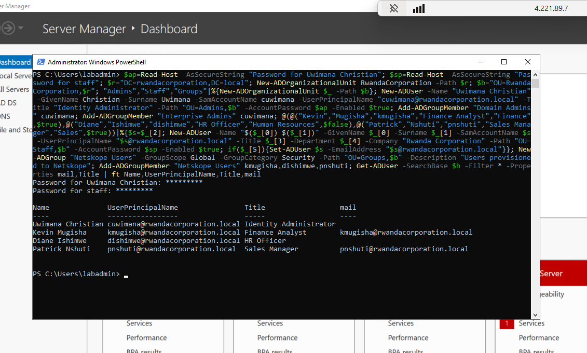

**2. In Entra, Kevin gets a different sign-in name.** Microsoft Entra ID > Users > Kevin Mugisha after the first Connect Sync cycle. User principal name kmugisha@MngEnvMCAP693718.onmicrosoft.com, user type Member, account enabled, created Oct 31, 2026, 7:44 PM. rwandacorporation.local can't be verified in Entra, so the synced account gets an onmicrosoft.com UPN.

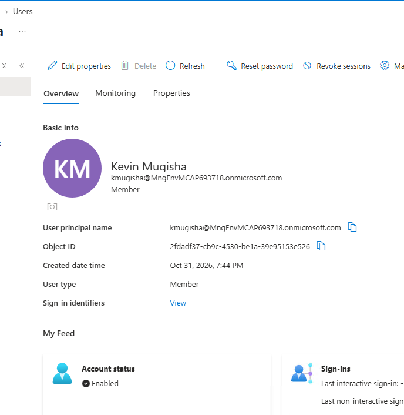

**3. His on-prem UPN is still there, alongside it.** The same user, Properties. Job title Finance Analyst, company Rwanda Corporation, department Finance. On-premises: sync enabled Yes, last synced Oct 31, 2026, 7:44 PM, distinguished name in OU=Staff, SAM account name kmugisha, on-premises user principal name kmugisha@rwandacorporation.local. Extension attributes is still empty. One account, two names: this is the mismatch the lab is about.

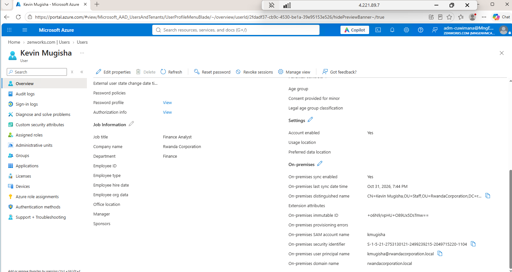

### The Netskope side, and the problem with the default mapping

**4. Three users already exist in "Netskope" under their on-prem UPN.** The SCIM test server's /ui page (times in UTC). Users: kmugisha@, dishimwe@ and pnshuti@rwandacorporation.local, all active, created at 00:24:44 by three POST /scim/v2/Users requests; no groups yet. The 00:17:34 GET is the deploy script's own check. This stands in for the users who were already in Netskope before provisioning was switched on.

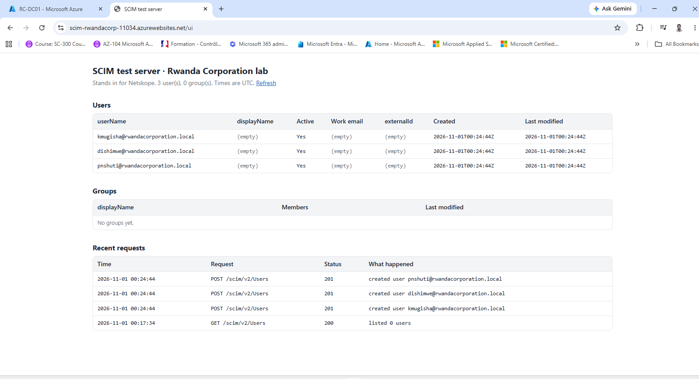

**5. Entra connects to the test server.** Enterprise apps > Netskope Rwanda Corporation > Provisioning. Tenant URL https://scim-rwandacorp-11034.azurewebsites.net/scim/v2, Secret Token masked. Test Connection: "The supplied credentials are authorized to enable provisioning". Provisioning Status is still Off.

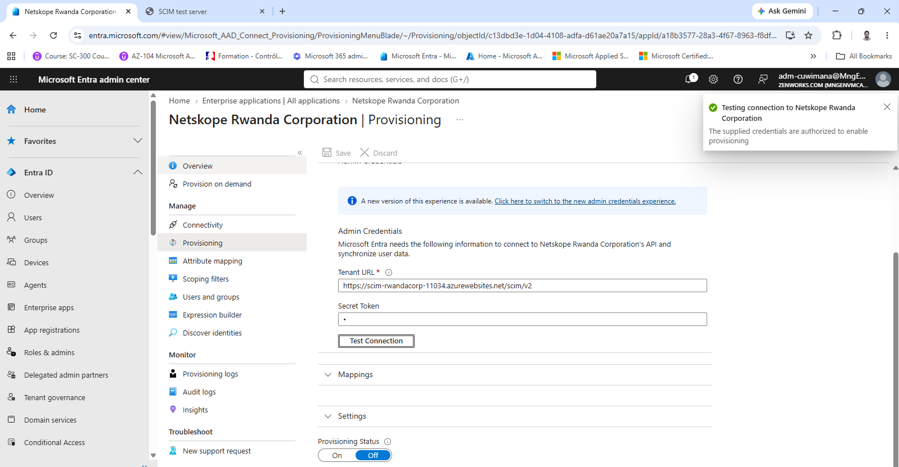

**6. The attribute the client needs isn't in the list.** Attribute mapping > the userPrincipalName to userName row (match objects Yes, matching precedence 1), Source attribute list open. It runs alphabetically from onPremisesSecurityIdentifier straight to originalUserPrincipalName: onPremisesUserPrincipalName isn't offered. That is why a schema edit looked necessary.

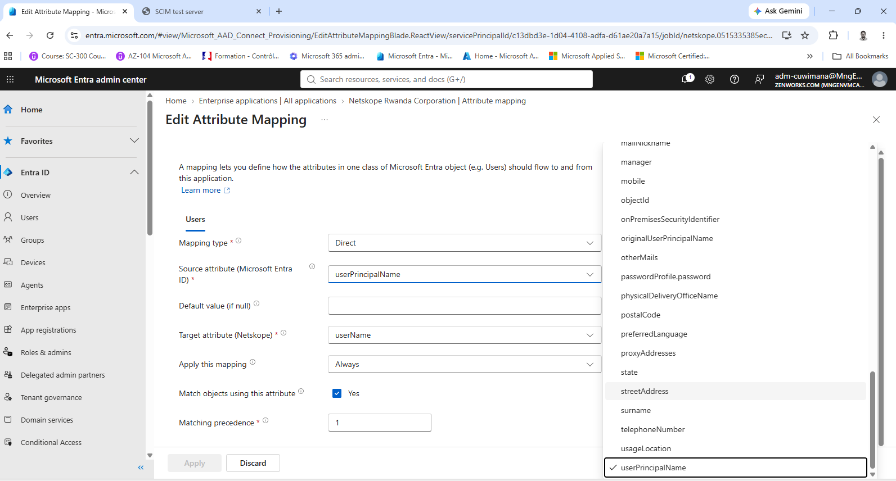

**7. With the default mapping, Entra creates a second Kevin.** Provision on demand for Kevin Mugisha while Create was still ticked: "User 'kmugisha@MngEnvMCAP693718.onmicrosoft.com' was created in Netskope". userName comes from [userPrincipalName], the cloud name; the work email, given name, surname, active and externalId (his Entra object ID, 2fdadf37-…) were sent too.

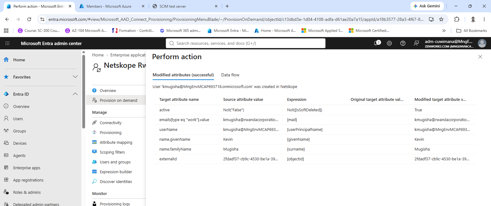

**8. What the server saw: a search that found nothing, then a create.** /ui (UTC): at 00:53:12 Entra's AzureAD_Test search, at 00:53:14 a search for userName "kmugisha@MngEnvMCAP693718.onmicrosoft.com" with no match, and at 00:53:15 a POST that created it. The server now holds four users, two of them Kevin. The duplicate was deleted before going on, and Create was unticked.

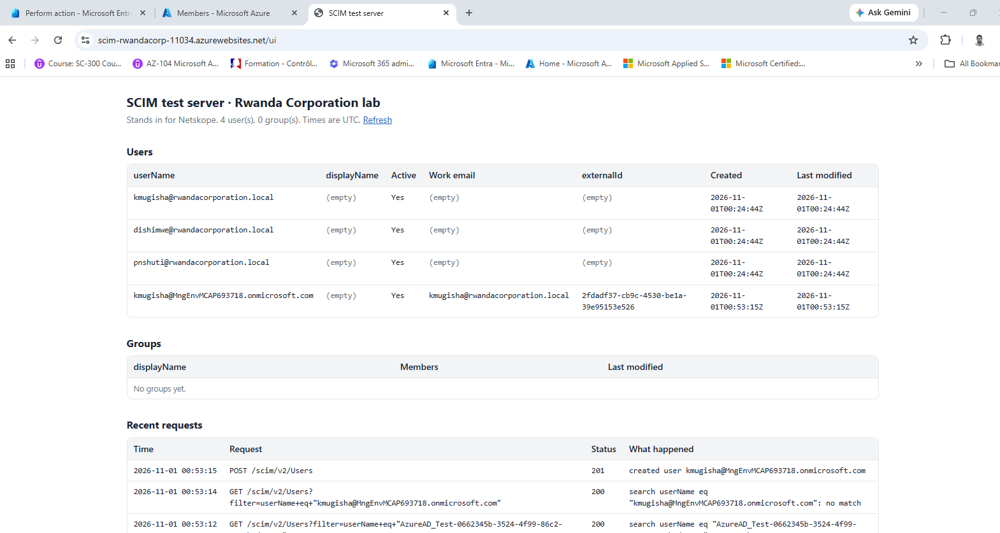

### The schema edit, the quarantine, and its cause

**9. After the schema edit, userName comes from onPremisesUserPrincipalName.** Attribute mapping after onPremisesUserPrincipalName was added to the schema: the first row now maps onPremisesUserPrincipalName to userName, Direct, matching precedence 1. The other rows are the gallery defaults: givenName, mail to the work email, Not([IsSoftDeleted]) to active, objectId to externalId, and surname.

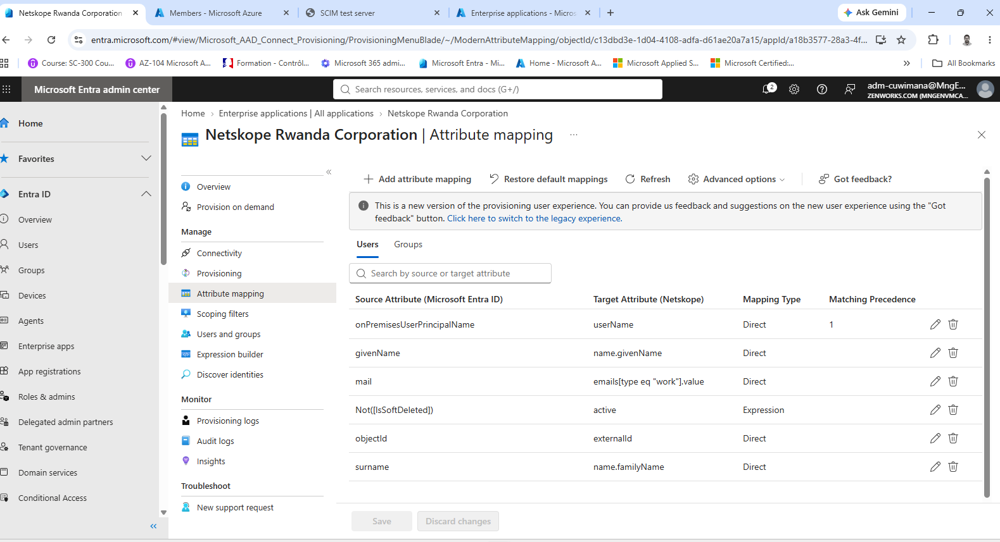

**10. The schema edit, line by line.** A comparison of the edited schema with the untouched template. Added: onPremisesUserPrincipalName on the Group object and on the User object; changed: originalUserPrincipalName from required False to True; the userName mapping from [userPrincipalName] to [onPremisesUserPrincipalName], matching 1 in both; and defaultSourceObjectMappings from userPrincipalName x2 to onPremisesUserPrincipalName x2. The two extension_… rows are directory extensions registered in this shared tenant, not part of the edit. The second command shows that in the template the matching attribute, userPrincipalName, is already required True, which is why the User copy shows True as well.

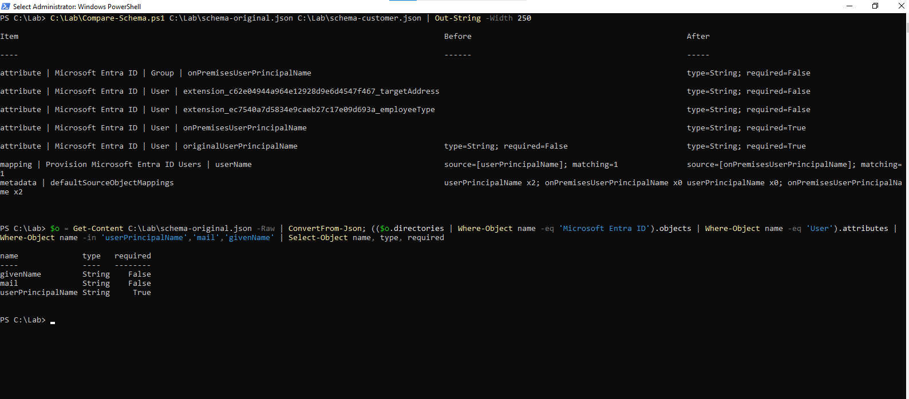

**11. For a single user, the edit seems to work.** Provision on demand for Kevin with the edited schema: "User 'kmugisha@MngEnvMCAP693718.onmicrosoft.com' was updated in Netskope". The only change was his work email, from [mail].

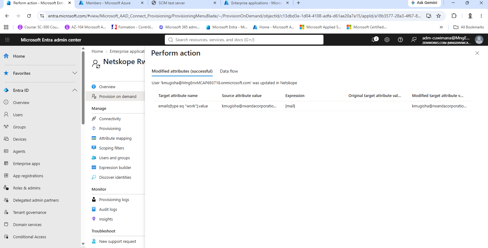

**12. The server confirms the match on the on-prem UPN.** /ui (UTC): at 01:57:18 a search for userName "kmugisha@rwandacorporation.local" that found him, and at 01:57:19 a PATCH that set his work email. Still three users, and Kevin's record is the one created at 00:24:44.

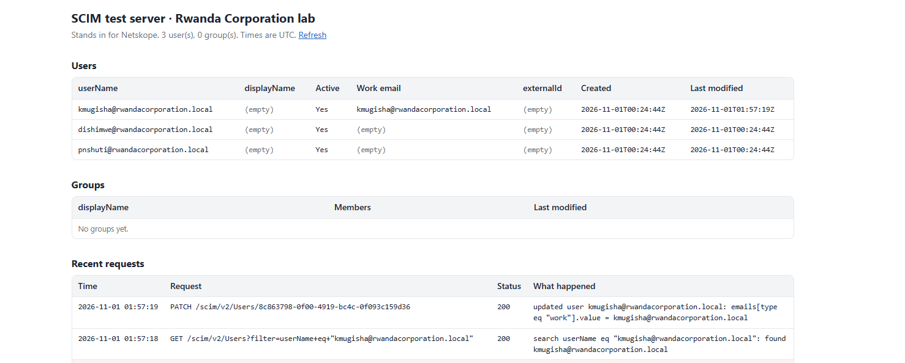

**13. The full cycle goes into quarantine.** Overview after provisioning was turned on. Current cycle status: Initial sync quarantined, 0% completed, 0 changes processed. Last cycle 4:13:48 to 4:13:50 AM (2.715 seconds), last time steady state achieved Never, next attempt 5:33:50 AM. Error code SchemaInvalid, error message "Invalid property: onPremisesUserPrincipalName".

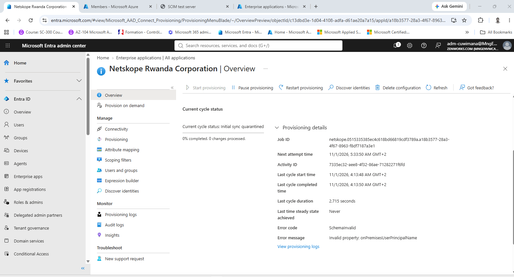

**14. Remove only the Group entry, and the cycle completes.** The same Overview after onPremisesUserPrincipalName was removed from the Group object only, with the other three edits left in place. Current cycle status: Initial sync completed, 100% completed, 3 users and 1 group. Last cycle 4:41:30 to 4:41:46 AM (15.150 seconds), steady state achieved 4:41:46 AM, provisioning interval 40 minutes. The Group entry is the cause of SchemaInvalid: Entra groups have no such property.

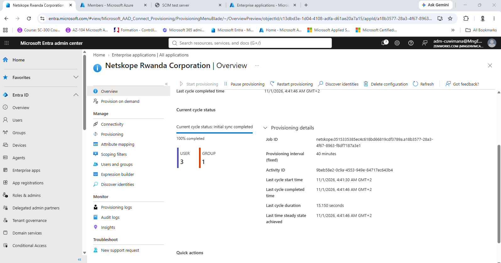

**15. That cycle matched the existing users and created the group.** /ui (UTC): Netskope Users created at 02:41:41 with no members, then three PATCH requests between 02:41:43 and 02:41:45 added kmugisha@, dishimwe@ and pnshuti@rwandacorporation.local. Still three users, all created at 00:24:44; Patrick's work email was added at 02:41:38.

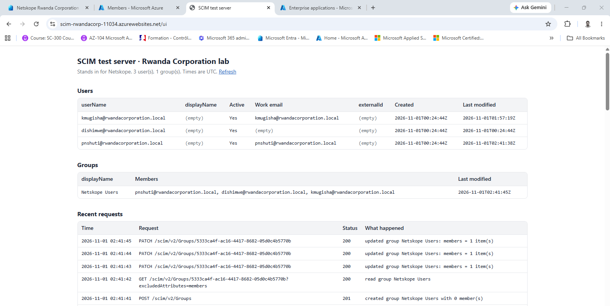

**16. The same cycle in Entra's provisioning log.** Provisioning logs, local time: at 4:41:37 to 4:41:38 AM Patrick Nshuti (Update), Diane Ishimwe and Kevin Mugisha (Other), each with a Target ID that is their record on the test server. Below them, Kevin's earlier on-demand runs at 3:57:19 AM and 3:48:29 AM. The 3:48 run went to a duplicate that an earlier cycle had created under his cloud name (Target ID 791d3cb1-…); that duplicate was deleted afterwards.

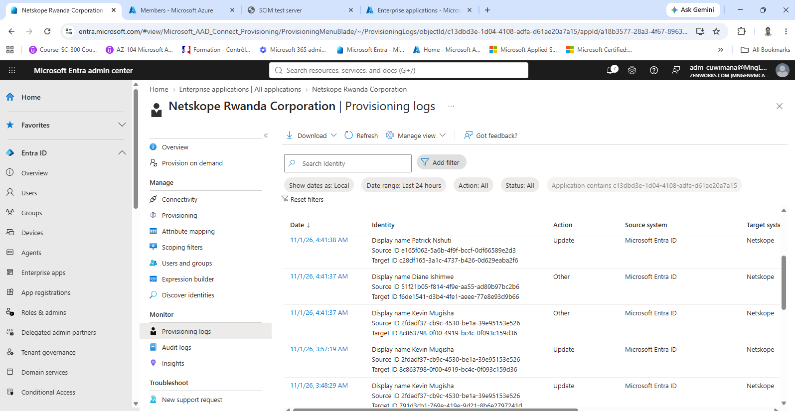

### Fix 1: copy the on-prem UPN with a sync rule

**17. One inbound rule in Connect Sync.** Synchronization Rules Editor, View inbound synchronization rule. Name "In from AD - User UPN to extensionAttribute10", description "Copies the on-prem UPN for the Netskope userName", connected system rwandacorporation.local, object type user to person, link type Join, precedence 50, not disabled. Behind it, the PowerShell command that paused the sync scheduler first.

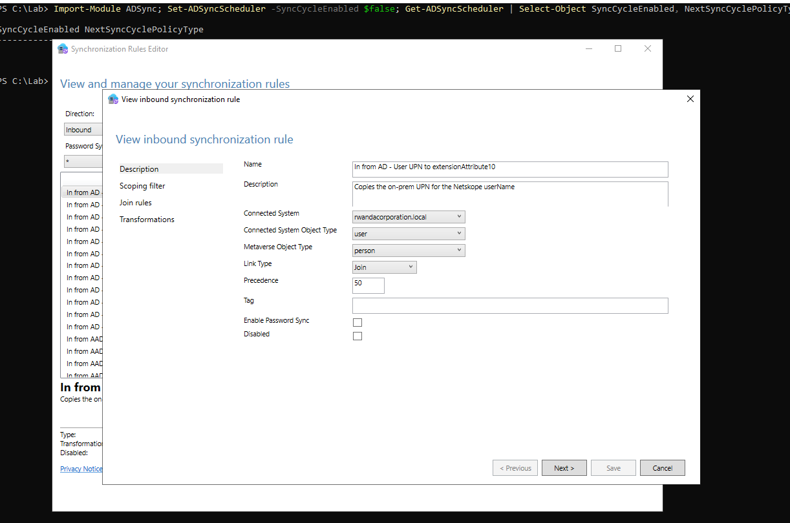

**18. A built-in outbound rule already sends it to Entra.** A built-in Out to AAD rule, opened with View (Save is greyed out): its transformations include extensionAttribute10 to extensionAttribute10, Direct, merge type Update, alongside the other extensionAttribute rows. No outbound rule had to be created.

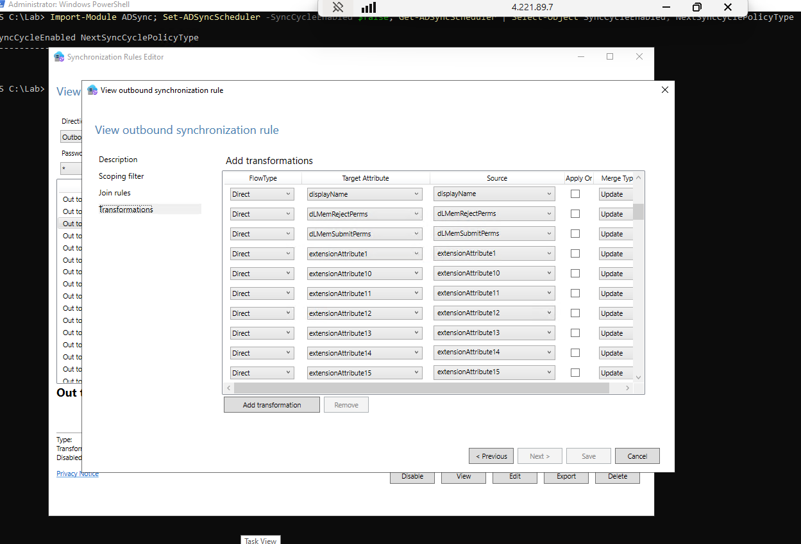

**19. The preview shows the rule working for Kevin.** Synchronization Service Manager on RC-DC01 > Preview > Import Attribute Flow, import flow mode full. The last row: "In from AD - User UPN to extensionAttribute10", data source userPrincipalName, Direct, metaverse attribute extensionAttribute10. The other rows are the standard rules filling Kevin's given name, mail and so on.

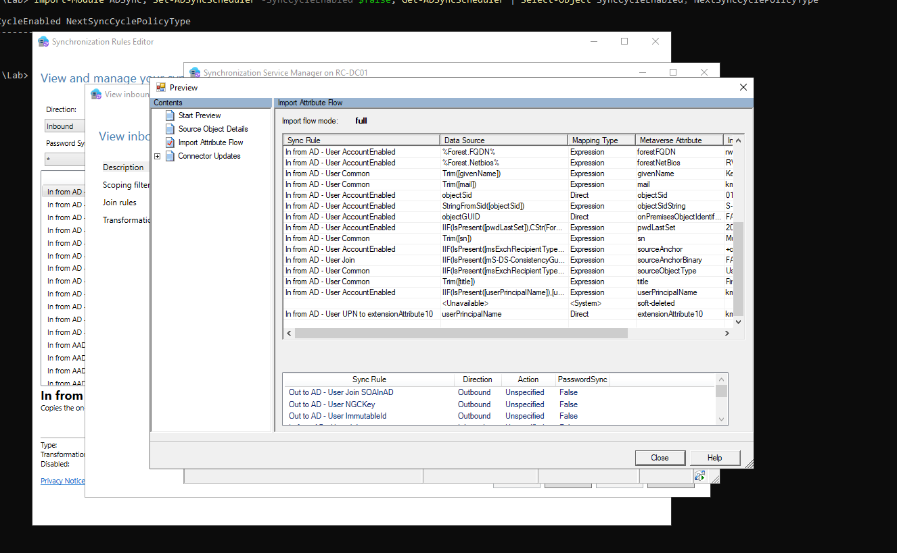

**20. In Entra, each synced user now carries the on-prem UPN.** Microsoft Graph PowerShell after the full sync. Diane, Kevin and Patrick have extensionAttribute10 equal to their on-prem UPN, @rwandacorporation.local; Diane gets hers even though she has no email. The cloud-only accounts, Boardroom Kigali and Uwimana Christian (Admin), have neither value.

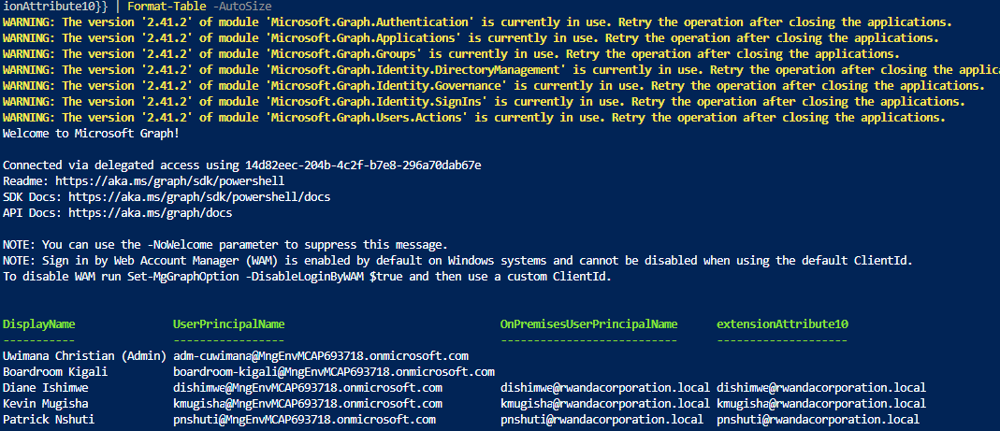

### Fix 2: remove the schema edit and map userName from extensionAttribute10

**21. Restore default mappings is only half the job.** The full sync and the scheduler switched back on (Result: Success). Then the schema after Restore default mappings, compared with the template: the mapping, the required flag and the rule metadata are back to default, but onPremisesUserPrincipalName is still on the User and Group objects, together with the two tenant extension attributes. The Group entry is the one that causes SchemaInvalid, so the clean template had to be pasted back as well.

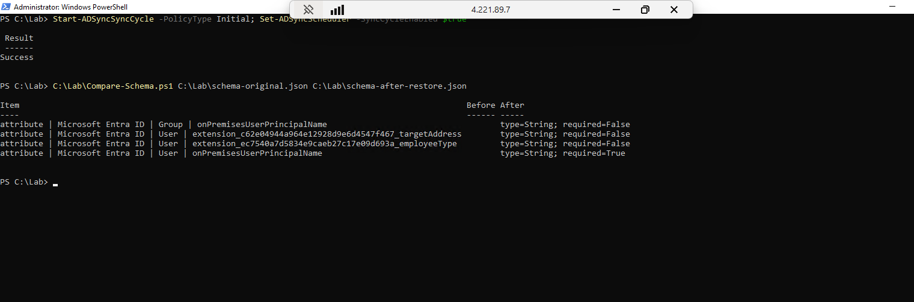

**22. userName now comes from extensionAttribute10.** Attribute mapping after the fix: extensionAttribute10 to userName, Direct, matching precedence 1. Every other row is the gallery default; no schema edit is left.

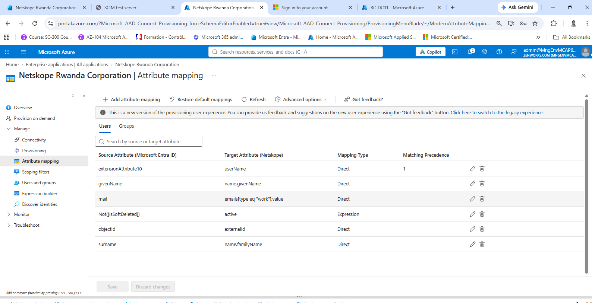

**23. Kevin matches his existing Netskope account.** Provision on demand for Kevin: import, scope and match all Success. Match details: "Retrieved 'kmugisha@rwandacorporation.local' from Netskope", id 8c863798-…, the record created at 00:24:44, with his work email, given name and surname.

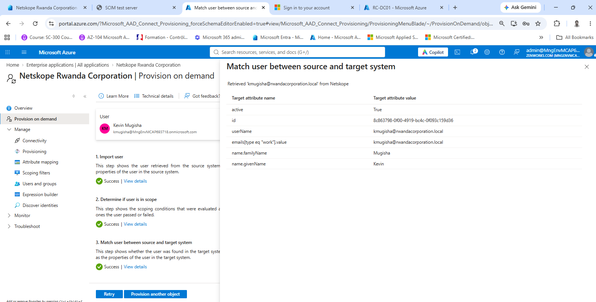

**24. The first full cycle after the fix: reads, no creates.** /ui (UTC) at 13:56: Entra's AzureAD_Test searches, then it reads Kevin, Patrick and Diane by their existing IDs (13:56:29 to 13:56:30), reads the Netskope Users group and sends its three members again (13:56:34 to 13:56:36). Still three users and one group.

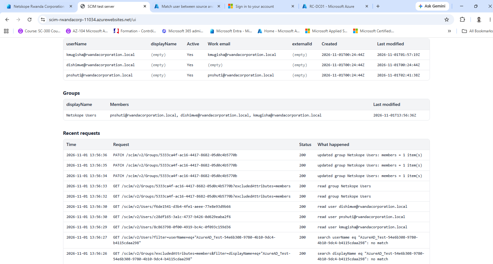

### It runs on its own

**25. A new joiner gets the value with no script.** Aline Ingabire was created in AD and added to Netskope Users; after a delta sync, Graph shows her extensionAttribute10 as aingabire@rwandacorporation.local.

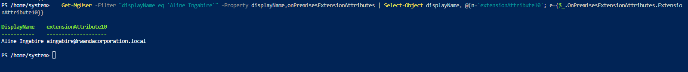

**26. The regular cycle created her in "Netskope".** /ui (UTC): aingabire@rwandacorporation.local created at 14:16:58, with externalId fd31f1c7-…, and Netskope Users updated to four members at 14:17:05. Four users in all. The 14:19:21 read is the Provision on demand that followed.

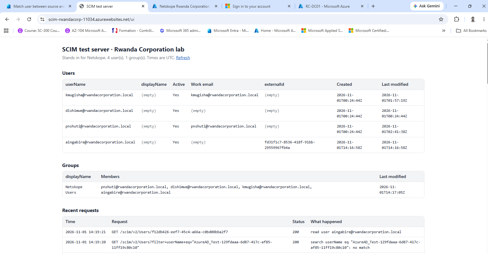

**27. Provision on demand finds her already there.** Match details for Aline: "Retrieved 'aingabire@rwandacorporation.local' from Netskope", id f12db426-…, externalId fd31f1c7-…, given name Aline, surname Ingabire.

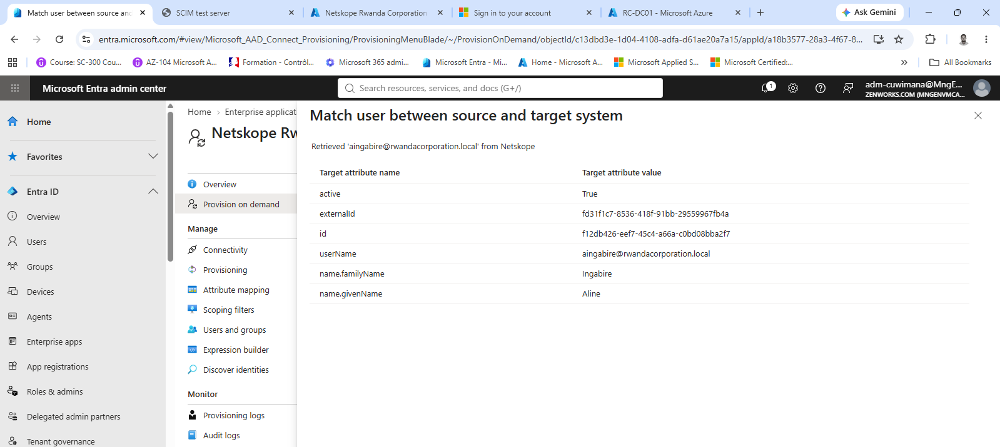

**28. Patrick's UPN changes in AD.** Set-ADUser pnshuti -UserPrincipalName patrick.nshuti@rwandacorporation.local, then a delta sync (Result: Success).

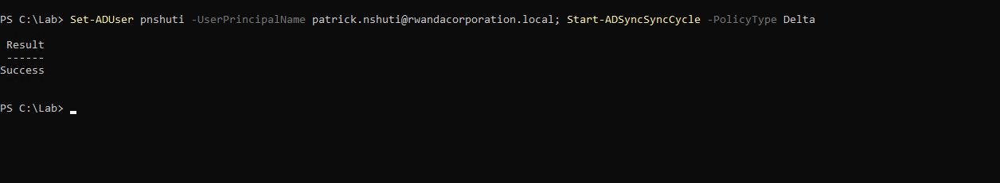

**29. The new UPN reaches extensionAttribute10.** Graph: Patrick Nshuti's extensionAttribute10 is now patrick.nshuti@rwandacorporation.local.

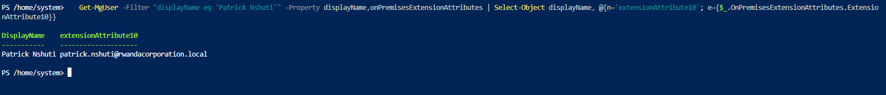

**30. Entra goes to the same Netskope record.** Match details for Patrick: "Retrieved 'pnshuti@rwandacorporation.local' from Netskope", id c28df165-…, his existing record still under the old name.

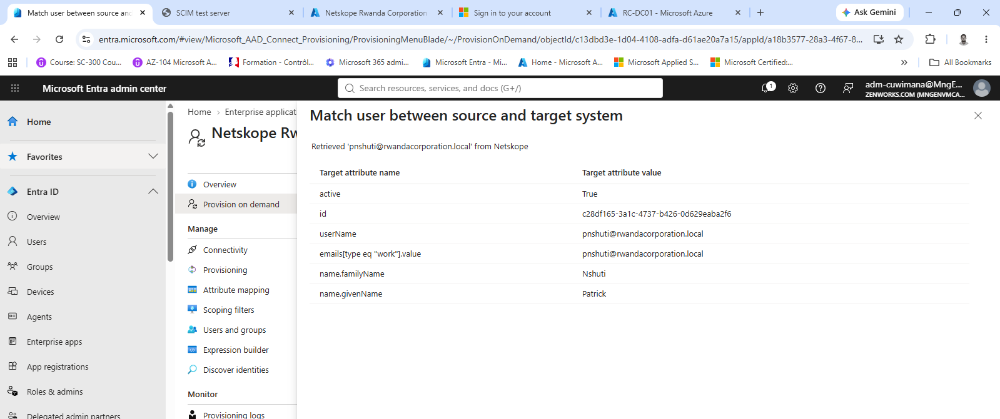

**31. The rename is an update, not a new account.** "User 'pnshuti@MngEnvMCAP693718.onmicrosoft.com' was updated in Netskope": userName changed to patrick.nshuti@rwandacorporation.local, from [extensionAttribute10].

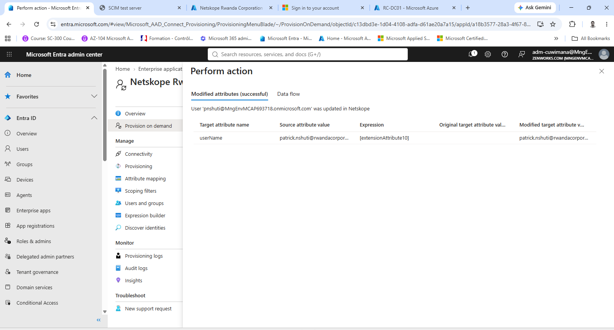

**32. A cloud-only account has nothing to send.** Users > Boardroom Kigali > Properties: account enabled Yes, on-premises sync enabled No, and every on-premises field, including extension attributes, empty.

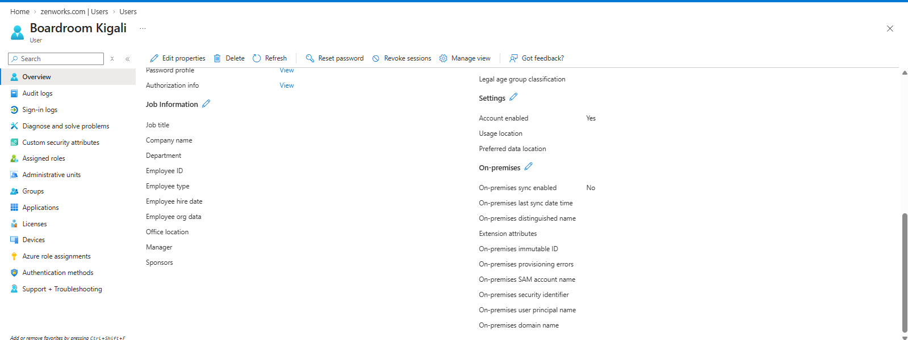

**33. Entra skips it instead of failing.** Provision on demand for Boardroom Kigali: "will be skipped. The User in Microsoft Entra ID does not have a value for at least one matching attribute." SkipReason UnprocessableEntry.

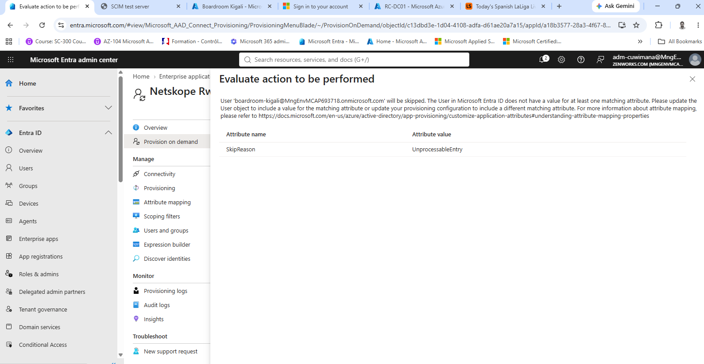

**34. The Netskope side after these tests.** /ui (UTC): four users. Patrick's record keeps its created time, 00:24:44, and now reads patrick.nshuti@rwandacorporation.local (last modified 14:30:07); Aline is the only account created by provisioning. Netskope Users has four members. The latest requests are Entra's connection test at 14:35; nothing appears for Boardroom Kigali.

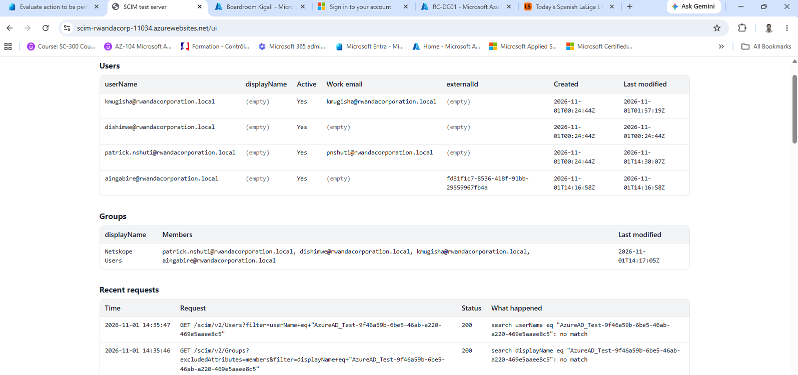

**35. What the Netskope client checks.** runas on RC-DC01 for Kevin and Aline: whoami /upn returns kmugisha@rwandacorporation.local and aingabire@rwandacorporation.local, the same values as their userName in "Netskope" and their extensionAttribute10 in Entra.

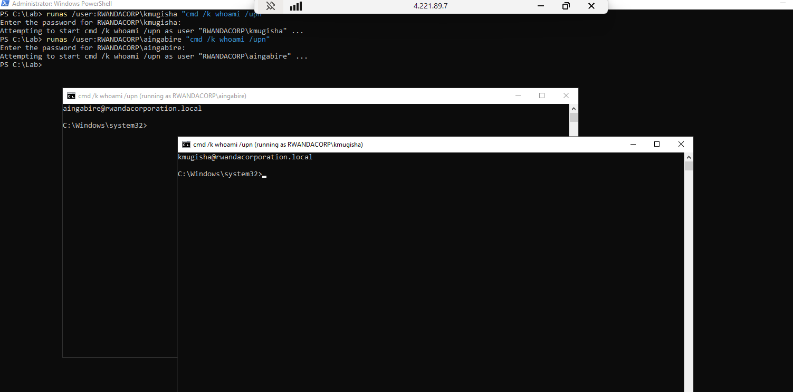

### Monitoring

**36. Readiness report: every group member is ready.** A Graph PowerShell report over the members of Netskope Users: cloud UPN, on-prem UPN, extensionAttribute10 and Ready. Kevin, Diane, Patrick (patrick.nshuti@) and Aline all show extensionAttribute10 equal to their on-prem UPN, and Ready True.

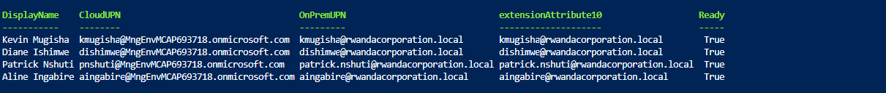

**37. A test failure: rename Diane to a name already taken.** With an orphan account called diane.ishimwe@rwandacorporation.local already on the test server, Diane's UPN is changed to that name in AD and a delta sync is run (Result: Success).

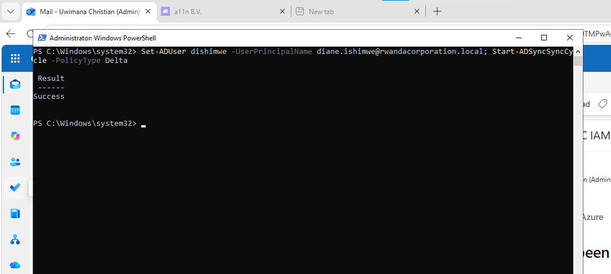

**38. The rename fails with 409 Conflict.** Provision on demand for Diane: import, scope and match Success, then "Failed to update User 'dishimwe@MngEnvMCAP693718.onmicrosoft.com' in Netskope". Error code SystemForCrossDomainIdentityManagementServiceIncompatibleFiltering; status Conflict; the server's response: "A resource with userName 'diane.ishimwe@rwandacorporation.local' already exists", scimType uniqueness.

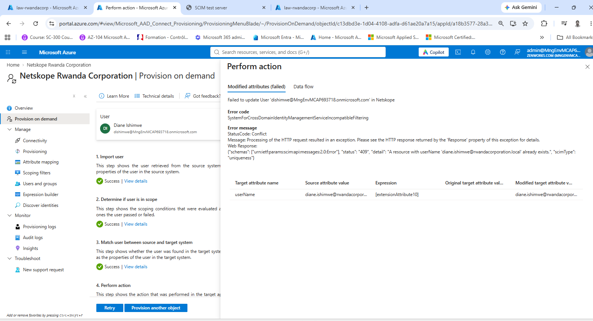

**39. The failure alert fires.** law-rwandacorp > Alerts: four Netskope provisioning failures alerts, severity 2 - Warning. The latest fired at 11/2/2026, 12:37 AM local time, from Log Alerts V2: "The query condition crossed the threshold of 0 and reached 1." It kept firing while the conflict lasted.

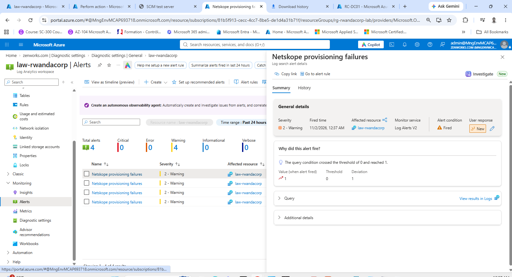

**40. And it reaches the inbox.** Outlook for Uwimana Christian (Admin): "You're now in the RC IAM action group", then four "Netskope provisioning failure – Rwanda Corporation lab" emails at 21:52, 22:07, 22:22 and 22:37 UTC. The first one, open: alert name Netskope provisioning failures, Sev2, monitor condition Fired, affected resource law-rwandacorp in rg-rwandacorp-lab, description "Any failed provisioning event for the Netskope app (Rwanda Corporation lab)", Log Alerts V2, fired November 1, 2026 21:52 UTC.

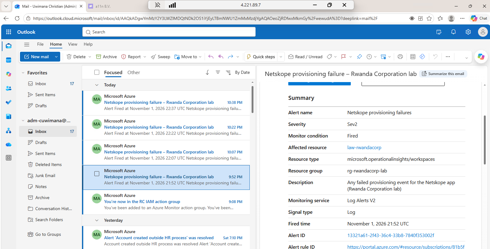
